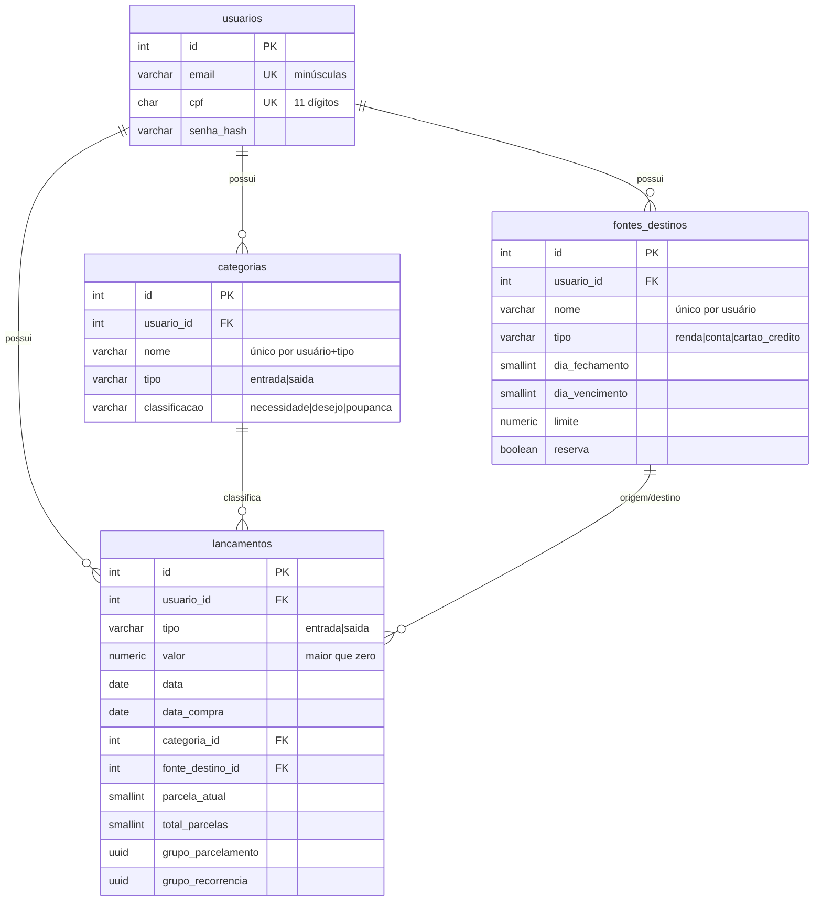

# Banco de dados — PostgreSQL

DDL completo: [`backend/database/schema.sql`](../backend/database/schema.sql).

## Modelo

## O que o banco garante (e a API não precisa conferir de novo)

| Regra | Como |
|---|---|
| E-mail e CPF únicos | `UNIQUE` em `usuarios.email` e `usuarios.cpf`. É atômico: duas requisições simultâneas não passam juntas. A API trata o erro `23505` e responde 409 no campo certo |
| Unicidade só vale com dado normalizado | `CHECK (email = LOWER(email))` e `CHECK (cpf ~ '^[0-9]{11}$')` |
| Nome de categoria/fonte repetido | Índice único com `LOWER(nome)`: "Lazer" e "lazer" são o mesmo |
| Dinheiro sem erro de arredondamento | `NUMERIC(12,2)`, nunca `float`. Os cálculos da API ainda usam centavos inteiros |
| Valor positivo, tipo válido, parcelas 1–48 | `CHECK` |
| Cartão exige fechamento, vencimento e limite | `CHECK` em `fontes_destinos` |
| Lançamento só usa categoria e fonte do mesmo dono | FK composta `(categoria_id, usuario_id)` → `categorias(id, usuario_id)` (idem para a fonte). Mesmo que a API erre, o banco recusa dado cruzado entre usuários |
| Não excluir categoria/fonte com lançamentos | FK sem `ON DELETE`: o banco recusa (erro `23503`) e a API responde 409 |
| Parcelas: todas ou nenhuma | `transacao()` em `config/db.js` (`BEGIN`/`COMMIT`/`ROLLBACK`) |

## Decisões

- **Colunas além do enunciado:** `categorias.classificacao` (regra 50/30/20), `fontes_destinos.reserva` (reserva de emergência), `lancamentos.data_compra` (base do cálculo da fatura) e `lancamentos.grupo_recorrencia` (mensalidades fixas).
- **`data` x `data_compra`:** em compra parcelada, cada parcela guarda em `data` o mês em que pesa no orçamento e, em `data_compra`, a data original. A fatura é calculada com `calcularFatura(data_compra, cartao, parcela_atual)`.
- **Pool de conexões:** `pg.Pool` (máx. configurável em `DB_POOL_MAX`), em `config/db.js`.
- **Transação sem mudar os models:** `consulta()` usa a conexão da transação em andamento (guardada em `AsyncLocalStorage`) ou, se não houver, o pool. Os models não sabem se estão dentro de uma transação.
- **Conversão de tipos num só lugar:** `config/db.js` converte `DATE` para texto `AAAA-MM-DD` e `NUMERIC` para número, antes de chegar aos models.
- **SQL parametrizado:** valores sempre via `$1, $2...`. Nomes de coluna em `UPDATE` dinâmico vêm de uma lista fixa no código, nunca da requisição.
